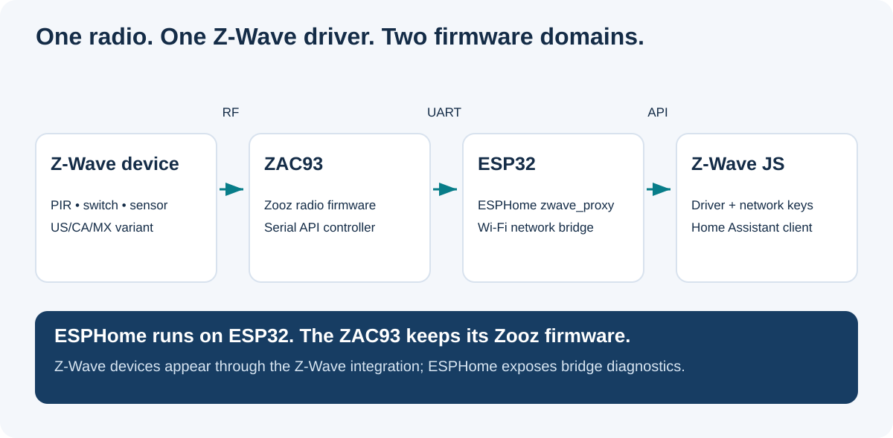
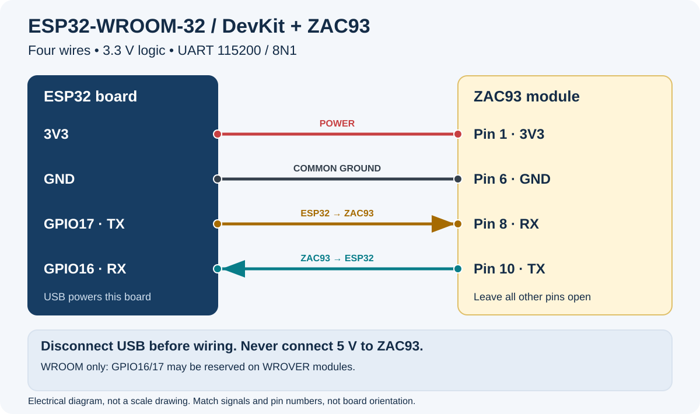
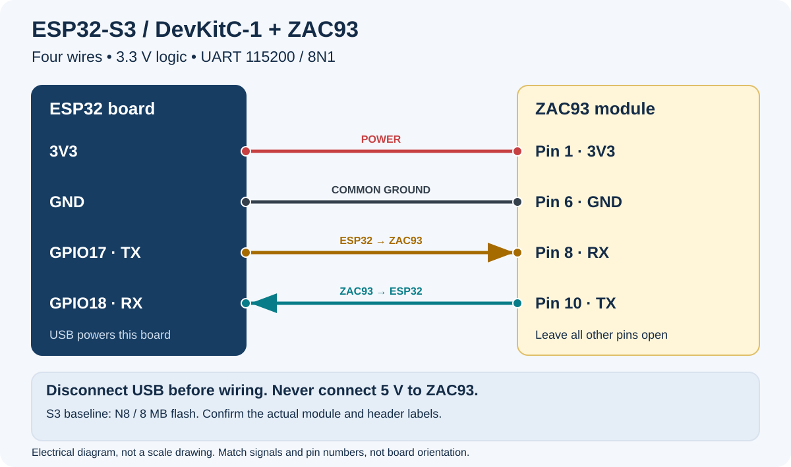
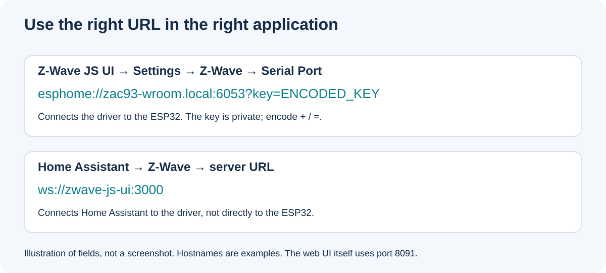
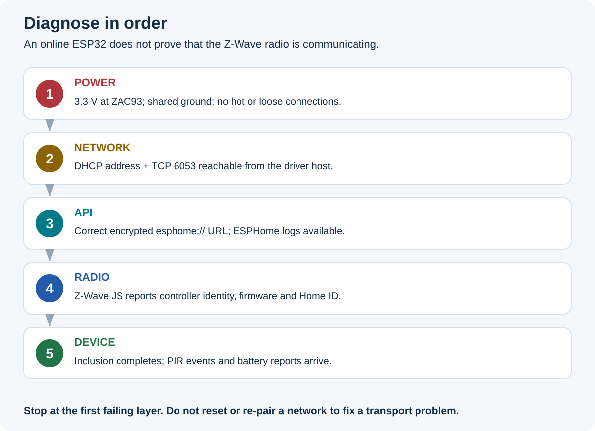

# ZAC93 + ESP32 → Home Assistant

[English](README.md) · [Русский](README.ru.md) · [Deutsch](README.de.md) · [Español](README.es.md) · [Wiki-Quelldateien](wiki/Home.md)

Ein bebilderter Aufbauleitfaden für einen lokalen Z-Wave-Controller: **Zooz ZAC93**, **ESP32-WROOM oder ESP32-S3**, die native Z-Wave-Proxy-Komponente von ESPHome und ein Z-Wave-JS-Server.

**Nachweisstand:** Die Hardware wurde bestellt; die physische Inbetriebnahme steht aus. Erfolgreiche Softwareprüfungen bedeuten nicht, dass Funkreichweite, Stromversorgung oder Geräteaufnahme bereits getestet wurden. Der [Prüfbericht](docs/validation.md) trennt diese Aussagen ausdrücklich. Diese deutsche Einstiegsanleitung ergänzt die ausführlichen englischen Referenzseiten und den [russischen Leitfaden](docs/guide-ru.md).



Der ESP32 stellt die Netzwerkverbindung bereit. Der ZAC93 übernimmt den Z-Wave-Funk und behält seine Zooz-Firmware. Home Assistant verbindet sich mit dem Z-Wave-JS-Server. Die separate Aufnahme des ESP32 in die ESPHome-Integration allein fügt keine Z-Wave-Geräte hinzu.

## Hardware und Anschluss

Für nordamerikanische Endgeräte den [ZAC93 in der Ausführung US/CA/MX](https://www.thesmartesthouse.com/products/zooz-800-series-z-wave-long-range-gpio-module-zac93-lr) wählen. Die Region von Controller und Endgerät muss übereinstimmen. Eine Antenne ist auf dem Modul vorhanden; eine externe Antenne ist nicht erforderlich. Ein älterer Z-Wave-Plus-Sensor wird durch diesen Controller nicht zu einem Long-Range-Gerät. Der historische Preis im englischen README ist keine aktuelle Preiszusage.

Benötigt werden außerdem eine passende ESP32-Entwicklungsplatine, vier kurze isolierte Verbindungen, ein USB-Datenkabel, eine ausreichende USB-Stromversorgung und eine nichtleitende Befestigung. Die beiden Referenzen sind **ESP32-WROOM-32/32D/32E** und **ESP32-S3-DevKitC-1 N8**. Andere Platinen benötigen eine Prüfung ihrer eigenen Pinbelegung und Flash-Größe.

Für **WROOM** gelten diese vier elektrischen Verbindungen:

- ESP32 **3V3 → ZAC93 Kontakt 1, 3V3**.
- ESP32 **GND → ZAC93 Kontakt 6, GND**.
- ESP32 **GPIO17 / TX → ZAC93 Kontakt 8 / RX**.
- ESP32 **GPIO16 / RX ← ZAC93 Kontakt 10 / TX**.

Beim Referenzaufbau mit **S3** wird nur der Empfangspin zu **GPIO18 / RX** geändert. Die zugehörigen Dateien sind [WROOM](firmware/esp32-wroom.yaml) und [S3](firmware/esp32-s3.yaml). Die WROOM-Belegung nicht ungeprüft für WROVER übernehmen: GPIO16/17 können dort für PSRAM verwendet werden.





**Versorgung und UART-Pegel des ZAC93 betragen 3,3 V. Nicht an 5 V oder VIN anschließen.** Vor dem Verdrahten USB abziehen. Die Zeichnungen zeigen elektrische Signale, keine universelle mechanische Orientierung. Aufdrucke und die [Referenzfotos mit Erläuterungen](docs/hardware.md) prüfen; beim Umdrehen der Platine erscheint die Anordnung spiegelverkehrt. Die unbenutzten Kontakte frei lassen. Keine zweite Versorgung gleichzeitig auf 3V3 einspeisen.

## ESP32 vorbereiten

ESPHome wird auf den **ESP32**, nicht auf den ZAC93 geschrieben. Die gemeinsame Konfiguration verwendet die in [requirements.txt](requirements.txt) festgelegte ESPHome-Version **2026.9.1**. Die CI nutzt Python 3.12.

```sh
git clone https://github.com/ha-homelab/zac93-esp32.git
cd zac93-esp32
python3 -m venv .venv
. .venv/bin/activate
python -m pip install -r requirements.txt
cp firmware/secrets.example.yaml firmware/secrets.yaml
openssl rand -base64 32
```

In `firmware/secrets.yaml` das lokale 2,4-GHz-WLAN, den erzeugten Base64-Wert als `api_encryption_key` für API und verschlüsselte OTA-Updates eintragen. Diese Datei und kompilierte Firmware nicht veröffentlichen. API und OTA verwenden denselben Geräteschlüssel; Z-Wave-Netzwerkschlüssel bleiben getrennt. OTA benötigt den festgelegten ESPHome-Client; unverschlüsselte Uploads werden abgewiesen.

Für WROOM prüfen, bauen und den tatsächlichen seriellen Port ermitteln:

```sh
esphome config firmware/esp32-wroom.yaml
esphome compile firmware/esp32-wroom.yaml
python -m serial.tools.list_ports
esphome run firmware/esp32-wroom.yaml --device /dev/ttyUSB0
```

`/dev/ttyUSB0` ist ein Platzhalter für den Port der eigenen Platine. Für S3 in diesen Befehlen `esp32-s3.yaml` verwenden. Der S3-Referenzaufbau hat 8 MB Flash; andere Varianten müssen vor einer Änderung identifiziert werden. Für die erste Installation kann der ZAC93 noch getrennt bleiben. Danach USB abziehen, verdrahten und wieder einschalten. Weitere Hinweise zu BOOT/RESET, dem Device Builder und OTA stehen in der [Firmware-Anleitung](docs/firmware.md).

## Verbindung zu Home Assistant

1. **Einen Z-Wave-JS-Server bereitstellen.** Z-Wave JS UI bietet eine Einstellungsoberfläche. Bei HA OS kann es als Community-App/Add-on laufen, bei Container/k3s als separater Dienst mit dauerhaftem Speicher für `/usr/src/app/store`. Nur ein Z-Wave-Treiber darf diesen Controller gleichzeitig benutzen.
2. **Server mit dem ESP32 verbinden.** Der Server benötigt Netzwerkzugriff auf TCP 6053 des ESP32. Eine DHCP-Reservierung erleichtert den Betrieb. `python3 scripts/connection_url.py zac93-wroom.local` fragt den API-Schlüssel verdeckt ab und erzeugt eine korrekt kodierte `esphome://`-URL. Für S3 `zac93-s3.local` verwenden. Diese geheime URL kommt in **Z-Wave JS UI → Settings → Z-Wave → Serial Port**. Nicht durch eine alte `tcp://…:6639`-Anleitung ersetzen.
3. **HA mit dem Server verbinden.** In Z-Wave JS UI den **WS Server** aktivieren, normalerweise TCP 3000. In HA die Z-Wave-Integration mit benutzerdefinierter Installation auswählen und den Server angeben, beispielsweise `ws://zwave-js-ui:3000`. Das ist ein DNS-Beispiel, keine universelle Adresse. Hier gehört nicht die Adresse des ESP32 hin. MQTT ist für diese Integration nicht erforderlich.
4. **Endgerät aufnehmen.** Inclusion über HA oder Z-Wave JS UI starten und die Anleitung des Sensors befolgen. Batteriesensoren während des Interviews wach halten. Ein bereits anderswo aufgenommenes Gerät kann zuerst ein reguläres Exclusion benötigen. Nicht deswegen den Controller zurücksetzen.



Die [ausführliche HA-Anleitung](docs/home-assistant.md) enthält externe, gekennzeichnete Referenzscreenshots. Bei einer neuen leeren Z-Wave-Installation Netzwerkschlüssel erzeugen und sichern. Bei der Migration eines vorhandenen Netzes bestehende Schlüssel und NVM erhalten. Die ESPHome-API-Verbindung allein beweist weder ein funktionierendes Radio noch einen erfolgreichen Sensorbericht.

## Fehler eingrenzen und sichern



- **Keine stabile Stromversorgung:** Kabel, gemeinsame Masse, Orientierung und 3,3-V-Spannung prüfen. Eine falsche Versorgung nicht durch 5 V ersetzen.
- **ESP32 im Netz, aber keine API-Verbindung:** Erreichbarkeit vom Z-Wave-JS-Server aus prüfen; API-Schlüssel und URL-Kodierung vergleichen. mDNS funktioniert nicht zwangsläufig über VLAN-Grenzen.
- **API erreichbar, Controller fehlt:** Spannung abschalten und TX/RX sowie GPIOs vergleichen. UART ist 115200/8N1. Einen zweiten konkurrierenden Treiber ausschließen.
- **Controller vorhanden, Sensor fehlt:** Region, Batterie, Inclusion/Exclusion und Interview prüfen. Wenn Werte in Z-Wave JS UI ankommen, aber in HA fehlen, WS Server und HA-Integration untersuchen.

Die [Fehlersuche](docs/troubleshooting.md) beschreibt jede Ebene genauer. Die [Inbetriebnahme-Checkliste](docs/commissioning.md) dokumentiert echte Hardwaretests. NVM, Z-Wave-JS-UI-Speicher samt Netzwerkschlüsseln sowie ESPHome-Konfiguration und Geheimnisse privat sichern. Ein Factory Reset ist kein normaler Neustart und löscht den Netzwerkzustand. Radio-Firmware-Updates und Wiederherstellung über diesen Proxy sind hier noch nicht physisch nachgewiesen.

## Offline-Werkzeuge und Beiträge

Die [ergänzenden Offline-Werkzeuge](docs/community-tools.md) prüfen Rollenwechsel, Messwertverträge, synthetische HA-Szenarien und aufgezeichnete Sprachassistenten-Evidenz. Keines ersetzt die Funk-Inbetriebnahme. Das [Wiki](wiki/Home.md) enthält Navigation zu den maßgeblichen Anleitungen; seine Dateien sind im Repository versioniert.

```sh
python3 -m unittest discover -s tests -v
python3 scripts/check_docs.py
python3 scripts/render_diagrams.py
git diff --exit-code -- assets/diagrams
```

[Beiträge](CONTRIBUTING.md), [Sicherheit](SECURITY.md), [Quellen/Bildnachweise](docs/sources.md), [MIT-Lizenz](LICENSE). Fremde Fotos und Screenshots bleiben Material ihrer jeweiligen Rechteinhaber; sie zeigen keinen hier abgenommenen Aufbau.
