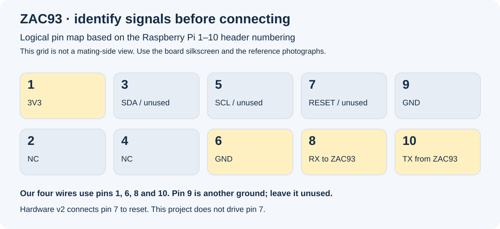

# ZAC93 + ESP32: сборка и подключение к Home Assistant

[Русская главная](../README.ru.md) · [English](../README.md) · [Deutsch](../README.de.md) · [Español](../README.es.md) · [Фотографии и подробные схемы](hardware.md) · [Скриншоты настройки HA](home-assistant.md) · [Wiki](../wiki/Home-ru.md)

**Состояние проекта:** модуль заказан; физическая сборка и проверка радиосвязи ещё не выполнены. Результаты программных проверок перечислены [отдельно](validation.md). Чужие фотографии и скриншоты подписаны и служат справочными примерами.

## Как это работает


ZAC93 — собственно радиоконтроллер Z-Wave. ESP32 связывает его UART с домашней сетью через штатный компонент ESPHome `zwave_proxy`. Постоянно работающий сервер **Z-Wave JS** управляет сетью, а Home Assistant подключается к нему. Для настройки удобно использовать **Z-Wave JS UI**.

ESPHome устанавливается **на ESP32**. ZAC93 сохраняет заводскую прошивку Zooz. Прошивка ESPHome не превращает обычный ESP32, передатчик 433 МГц, Zigbee-контроллер или Matter-хаб в радиоконтроллер Z-Wave.

Для североамериканских устройств нужен **ZAC93 US/CA/MX**. На странице продавца 14 октября 2026 года модуль стоил **$17.95**, без ESP32 и доставки. Внешняя антенна не нужна: на плате уже есть печатная. Регион устройства и контроллера должен совпадать. Старый датчик Z-Wave Plus не получает Long Range только от подключения к новому контроллеру. [Модуль](https://www.thesmartesthouse.com/products/zooz-800-series-z-wave-long-range-gpio-module-zac93-lr), [FAQ Zooz](https://www.support.getzooz.com/kb/article/1426-zac93-gpio-module-faqs/).

## Два варианта ESP32

### ESP32-WROOM-32 / DevKit


- **3V3 ESP32 → контакт 1 ZAC93, 3V3.**
- **GND ESP32 → контакт 6 ZAC93, GND.**
- **GPIO17 ESP32, TX → контакт 8 ZAC93, RX.**
- **GPIO16 ESP32, RX ← контакт 10 ZAC93, TX.**

Конфигурация: [esp32-wroom.yaml](../firmware/esp32-wroom.yaml). Подходит для указанного WROOM, а не автоматически для WROVER: у WROVER GPIO16/17 могут использоваться PSRAM.

### ESP32-S3-DevKitC-1


Питание, земля и TX такие же. **RX переносится на GPIO18**: GPIO18 ESP32-S3 ← контакт 10 ZAC93.

Конфигурация: [esp32-s3.yaml](../firmware/esp32-s3.yaml), базовый вариант N8 с 8 МБ flash. Для N16R8 после проверки маркировки изменить `flash_size` на `16MB`. PSRAM для моста не требуется. Произвольная плата S3 или плата из AiDot может иметь другую разводку — сначала проверить её схему.

### Как не перепутать контакты



Это **логическая карта**, а не вид со стороны вставляемого разъёма. При переворачивании платы расположение зеркалится. Сверять надписи `3V3`, `GND`, `RX`, `TX` на самой плате и [справочные фотографии](hardware.md). В старой фотографии ESP32 используются GPIO1/3; наша прошивка использует другие GPIO, указанные выше.

У ZAC93 питание и UART **3,3 В**. Не подключать к `5V` или `VIN`. Все соединения выполнять с отключённым USB. Остальные контакты оставить свободными; контакт 7 в аппаратной версии 2 связан со сбросом и здесь не используется. Сначала прошить ESP32 отдельно, затем обесточить, соединить четыре провода и снова подать питание через USB ESP32. Не подавать одновременно второе питание на 3V3. [Официальная инструкция Zooz](https://www.getzooz.com/downloads/zooz-z-wave-800-series-long-range-gpio-module-zac93-LR-manual.pdf).

## Прошивка ESP32

На компьютере с поддерживаемым Python:

```sh
git clone https://github.com/ha-homelab/zac93-esp32.git
cd zac93-esp32
python3 -m venv .venv
. .venv/bin/activate
python -m pip install -r requirements.txt
cp firmware/secrets.example.yaml firmware/secrets.yaml
openssl rand -base64 32
```

В `firmware/secrets.yaml` записать SSID/пароль Wi-Fi 2,4 ГГц, сгенерированный Base64-ключ в `api_encryption_key`; этот же ключ аутентифицирует шифрованные OTA-обновления. Отдельный пароль OTA не нужен. Этот файл, собранные бинарники и ключи не публиковать.

Проверка и сборка WROOM:

```sh
esphome config firmware/esp32-wroom.yaml
esphome compile firmware/esp32-wroom.yaml
python -m serial.tools.list_ports
esphome run firmware/esp32-wroom.yaml --device /dev/ttyUSB0
```

Заменить `/dev/ttyUSB0` на **реальный порт своей платы**. На Mac это обычно `/dev/cu.usbserial-…` или `/dev/cu.usbmodem…`, на Windows — `COM…`. Для S3 во всех командах выбрать `esp32-s3.yaml`; для первой установки удобен USB-to-UART разъём DevKitC-1. Нужен кабель с передачей данных. При проблеме входа в загрузчик использовать BOOT/RESET по инструкции платы.

В ESPHome Device Builder можно положить выбранный YAML, `common.yaml` и личный `secrets.yaml` в одну папку конфигурации. `common.yaml` сам по себе не является конфигурацией отдельного устройства. [Подробности установки и OTA](firmware.md).

## Подключение к Home Assistant


### 1. Сервер Z-Wave JS UI

В Home Assistant OS установить **Z-Wave JS UI** из Community Apps/add-ons. Для HA Container/k3s запустить отдельный постоянный сервис Z-Wave JS UI с сохранением `/usr/src/app/store`. Один контроллер должен обслуживаться **одним** драйвером: не запускать параллельно второй Z-Wave JS, в том числе во время rolling update.

Сервер должен видеть ESP32 по TCP **6053**. Home Assistant должен видеть сервер Z-Wave JS по TCP **3000**. Веб-интерфейс отдельного Z-Wave JS UI обычно работает на **8091**. В HA OS его можно открывать через интерфейс приложения. Эти три порта не взаимозаменяемы.

### 2. Подключить радио к драйверу

Закрепить адрес ESP32 в DHCP. Сформировать строку:

```sh
python3 scripts/connection_url.py zac93-wroom.local
```

Для S3 заменить имя на `zac93-s3.local`, либо использовать закреплённый IP. Ввести исходный API-ключ по скрытому приглашению. Полученный секретный URL вставить в **Z-Wave JS UI → Settings → Z-Wave → Serial Port**:

```text
esphome://zac93-wroom.local:6053?key=ENCODED_API_KEY
```

Утилита кодирует символы `+`, `/`, `=`: неправильная передача Base64-ключа может сломать авторизацию. В старых инструкциях встречается `tcp://…:6639`; для этой конфигурации он не подходит. Включить Z-Wave, сохранить и дождаться определения контроллера.

Для новой пустой сети создать Z-Wave security keys средствами UI и сохранить их резервную копию. При переносе существующей сети **сохранить прежние ключи и NVM**, не генерировать вместо них новые. Проверить регион USA/US для североамериканского модуля. Драйвер должен прочитать модель, прошивку и Home ID.

### 3. Подключить HA к драйверу

В Z-Wave JS UI включить **Home Assistant → WS Server**, обычно порт 3000. MQTT для штатной интеграции не нужен.

В HA: **Settings → Devices & services → Add integration → Z-Wave → Custom installation**. Снять флажок использования Supervisor add-on, если драйвер Z-Wave JS UI уже работает. Указать адрес сервера, например:

```text
ws://zwave-js-ui:3000
```

Это пример DNS-имени, не готовый адрес любой установки. Для распространённого HA OS add-on часто используется `ws://a0d7b954-zwavejsui:3000`; проверить имя своего приложения. В k3s — доступное из HA имя Service/FQDN. `localhost` внутри контейнера обычно указывает на сам контейнер. **Не вводить сюда адрес ESP32.**

Реальные скриншоты каждого экрана с пояснениями: [подключение к HA](home-assistant.md). Источник скриншотов — TubesZB; версия интерфейса может отличаться.

### 4. Добавить датчик

В HA или Z-Wave JS UI запустить включение в сеть (**inclusion / Add device**), затем выполнить действие по инструкции датчика. Держать батарейный датчик бодрствующим до завершения interview. Для Monoprice P/N 15902 используется Z-Wave, а не ZHA. Не предполагать поддержку SmartStart или LR, если её нет в инструкции конкретного устройства.

После появления датчика проверить настоящее событие движения сначала в Z-Wave JS UI, затем в HA. Если датчик раньше был в другой сети, может понадобиться штатное **exclusion**, затем новое inclusion. Сбрасывать весь контроллер для этого не нужно.

ESP32 также можно отдельно добавить через интеграцию **ESPHome** для uptime, Wi-Fi signal и версии прошивки. Нужен исходный API-ключ, не URL-кодированная строка. Статус `ESPHome API Connected` подтверждает только API-соединение; работоспособность радиоконтроллера и датчика он не доказывает.

## Диагностика по порядку


1. **Питание:** стабильные 3,3 В на ZAC93, общая земля, правильная ориентация разъёма. Если ESP32 перезагружается, проверить кабель, источник питания и регулятор. Не повышать питание ZAC93 до 5 В.
2. **Сеть:** адрес в DHCP; порт 6053 доступен именно с сервера драйвера. mDNS может не проходить между VLAN — попробовать закреплённый IP. Ping не проверяет API.
3. **API:** правильный ключ, `esphome://`, параметр `key`, корректное URL-кодирование. Посмотреть логи ESPHome.
4. **UART/радио:** если ESP32 доступен, но контроллер не определяется, обесточить и сверить TX/RX, землю, GPIO и 115200/8N1. Убедиться, что второй драйвер не захватил радио. Исправить соединение и перезапустить драйвер.
5. **Датчик:** совпадение региона, завершённый interview, батарея и пробуждение. Если значение есть в Z-Wave JS, но отсутствует в HA — проверять WS Server/3000 и интеграцию, а не переподключать радио.

Примеры только для чтения; `192.0.2.10` заменить настоящим адресом ESP32:

```sh
ping -c 3 192.0.2.10
nc -vz -w 3 192.0.2.10 6053
esphome logs firmware/esp32-wroom.yaml --device 192.0.2.10
```

Отсутствие прикладных логов на USB ожидаемо: последовательный logger отключён, логи читаются через API. Поведение LED ZAC93 зависит от версии прошивки. Кнопка на его плате не используется как универсальная кнопка pairing/reset. [Расширенный troubleshooting](troubleshooting.md).

## Резервирование и обновления

Сохранить NVM контроллера, каталог/настройки Z-Wave JS UI с security keys, конфигурацию ESPHome и личные секреты. Проверить, что резервная копия HA действительно включает внешний сервер: отдельный контейнер или PVC k3s обычно требует отдельного резервирования.

Обновление ESPHome меняет ESP32; прошивка Zooz обновляется отдельно штатным способом. На 14 октября 2026 года [Zooz указывает 2.30 / SDK 7.24.2](https://www.support.getzooz.com/kb/article/1389-zac93-gpio-module-change-log/); версия поставленного модуля пока неизвестна. Обновление радио через этот прокси нами не проверено — сначала подтвердить поддержку конкретного пути обновления.

Обычный restart не равен factory reset. **Factory reset контроллера стирает состояние сети.** Не использовать его для исправления Wi-Fi, ключа API или перепутанных TX/RX. Проверочный список для первого запуска и план резервирования: [commissioning](commissioning.md).
